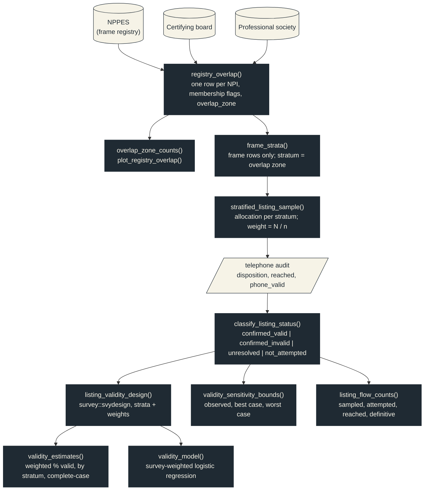

# mysteryroster 

<!-- badges: start -->
[](https://github.com/mufflyt/mysteryroster/actions/workflows/R-CMD-check.yaml)
[](https://lifecycle.r-lib.org/articles/stages.html#experimental)
[](https://opensource.org/licenses/MIT)
[](https://cran.r-project.org/)
[](https://orcid.org/0000-0002-2044-1693)
<!-- badges: end -->

Registry overlap strata and listing-validity analysis for mystery-caller
audits of physician directories.

## The question

National physician directories (NPPES, certifying boards, professional
societies) count different physicians and are rarely checked against reality.
A registry-validity study cross-links them, calls a stratified sample of listed
practices, and asks one thing of each physician-location listing: is the named
physician still practising the indexed specialty at the listed address?

`mysteryroster` is the specialty-agnostic core of that study. It was carved out
of the ENT registry-validity study (Falk et al.) so the OB/GYN subspecialty
study, and any later one, runs the same steps with its own registries and its
own disposition codebook.

## Installation

```r
# install.packages("remotes")
remotes::install_github("mufflyt/mysteryroster")
```

## How the pieces fit



Dark boxes are package functions; light shapes are your inputs. Every arrow
is a data frame handed from one call to the next, so the study is a straight
line from registries to tables.

## The study in six calls

```r
library(mysteryroster)

# 1. Cross-link registries by NPI. The first registry is the sampling frame.
ov <- registry_overlap(list(nppes = nppes_npis, board = board_npis, society = society_npis))
overlap_zone_counts(ov)        # seven Euler zones, closure-checked
plot_registry_overlap(ov)      # area-proportional Euler diagram (eulerr)

# 2. Protocol strata: the frame registry's overlap with the others.
frame <- frame_strata(ov, frame = "nppes")

# 3. A stratified sample that keeps its sampling probabilities.
listings <- stratified_listing_sample(
  frame, allocation = c("nppes" = 100, "nppes+board" = 150, "nppes+board+society" = 150),
  seed = 20261009)

# 4. Call dispositions become four exhaustive statuses.
calls <- classify_listing_status(call_log, map = ent_disposition_map())
table(calls$listing_status)    # confirmed_valid / confirmed_invalid / unresolved / not_attempted

# 5. Design-weighted estimates, bounds, and a survey-weighted model.
design <- listing_validity_design(calls)
validity_estimates(design, by = "stratum")
validity_sensitivity_bounds(calls)
validity_model(design, ~ stratum + rural)

# 6. The flow diagram's numbers, closure-checked.
listing_flow_counts(calls, by = "stratum")
```

The vignette runs this end to end on synthetic data:
`vignette("registry-validity-workflow", package = "mysteryroster")`.

## From protocol to function

| Protocol step | Function |
|---|---|
| Cross-link registries into mutually exclusive overlap zones | `registry_overlap()`, `overlap_zone_counts()`, `plot_registry_overlap()` |
| Restrict to the frame registry; define strata | `frame_strata()` |
| Stratified sample with preserved sampling probabilities | `stratified_listing_sample()` |
| Dispositions to confirmed valid, confirmed invalid, unresolved, not attempted | `classify_listing_status()`, `ent_disposition_map()`, `listing_status_levels()` |
| Design-weighted validity, overall and by stratum; complete-case estimate | `listing_validity_design()`, `validity_estimates()` |
| Extreme-case bounds for unresolved listings | `validity_sensitivity_bounds()` |
| Survey-weighted logistic regression | `validity_model()` |
| Study-flow counts | `listing_flow_counts()` |

## Design rules

- **One listing is the unit.** Nothing here aggregates to the physician; do
  that before sampling with your own one-listing-per-NPI rule.
- **Presence is never inferred.** A reached office, a non-missing new-patient
  answer, or board certification does not make a listing valid; only the
  disposition categories in the map do.
- **Unresolved is explicit.** It is reported as its own category, and the
  bounds table shows what the estimate would be if every unresolved listing
  were valid, or invalid.
- **Counts must partition.** Every count-producing function asserts that its
  categories sum to the input, and registry totals must close on their zones.
- **Codebook drift stops the run.** A disposition string outside the map is an
  error unless you ask for `unmapped = "unresolved"`.

## Disposition maps

`ent_disposition_map()` is the ENT study's REDCap vocabulary. A new study
supplies the same four categories with its own strings:

```r
obgyn_map <- list(
  at_location   = c("Yes, sees patients here", "Yes, but not accepting new patients"),
  relocated     = "Moved to another practice",
  retired       = c("Retired", "No longer practising"),
  not_specified = "No, reason not given")
classify_listing_status(call_log, map = obgyn_map)
```

## Related packages

- [`mysterynpi`](https://github.com/mufflyt/mysterynpi): name keys and
  agreement rules for linking person rosters to NPI (build the registries here
  first).
- [`mysterycall`](https://github.com/mufflyt/mysterycall): appointment-access
  outcomes, wait-time models, power, and study tooling.
- [`mysterymaps`](https://github.com/mufflyt/mysterymaps): maps for access studies.

## Citation

Muffly TM. mysteryroster: registry overlap strata and listing-validity analysis
for mystery-caller audits of physician directories. R package version 0.1.0.
https://github.com/mufflyt/mysteryroster

## License

MIT, Tyler Muffly.
