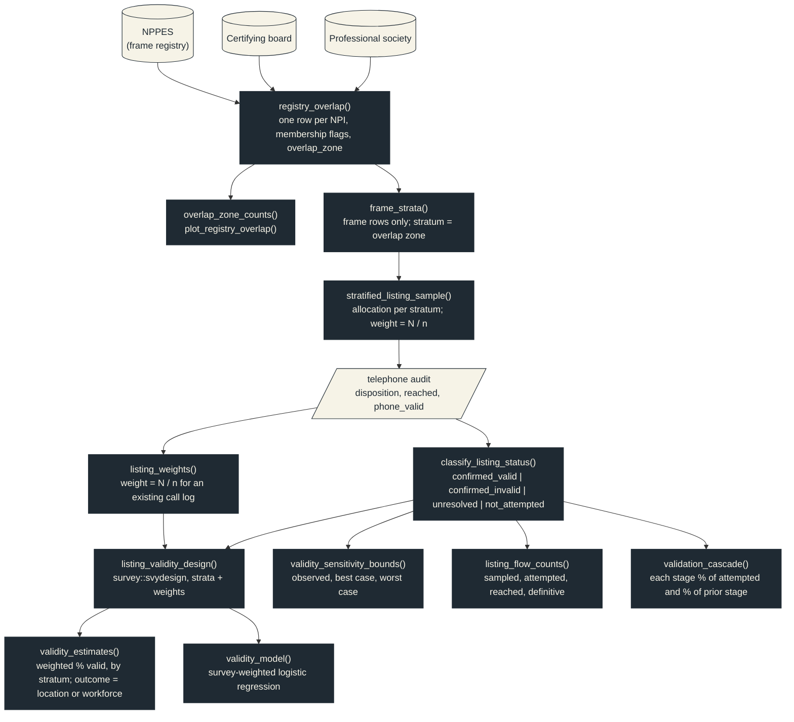
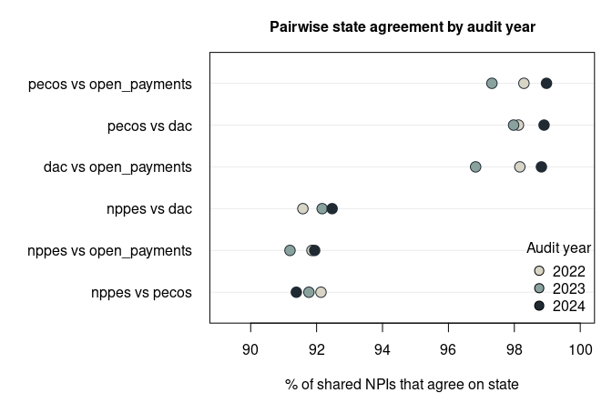
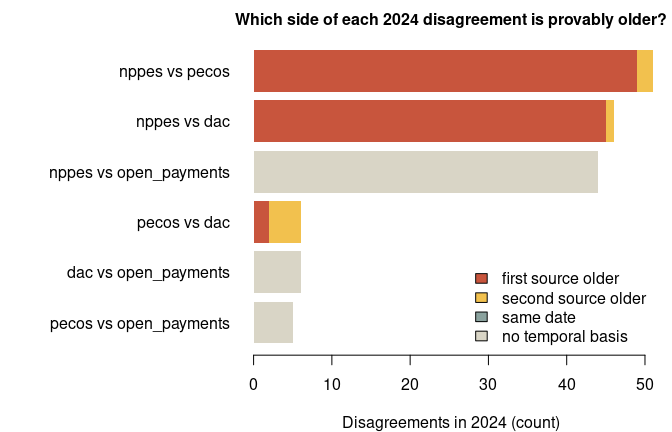
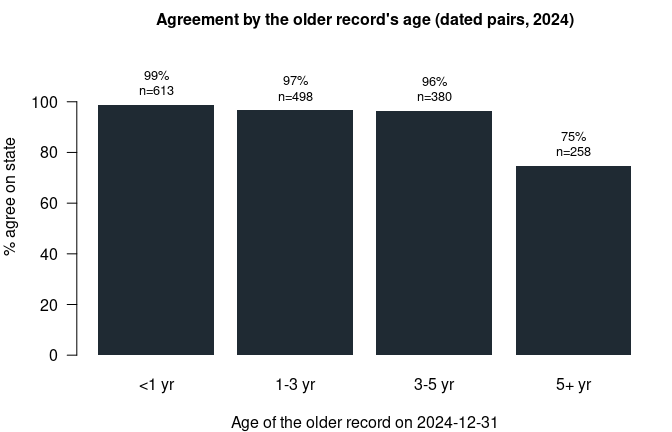
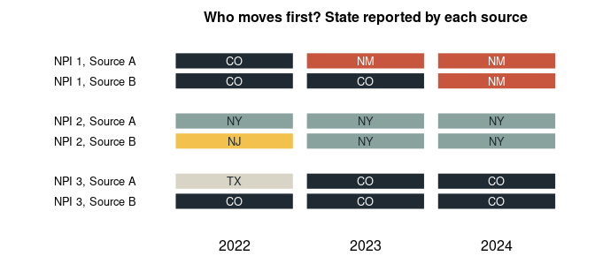
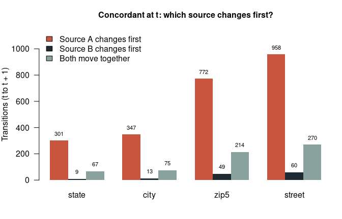
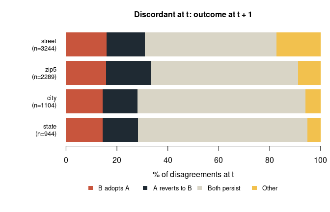
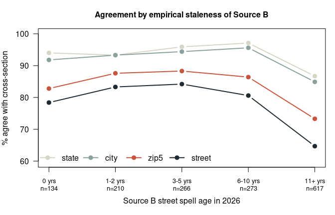
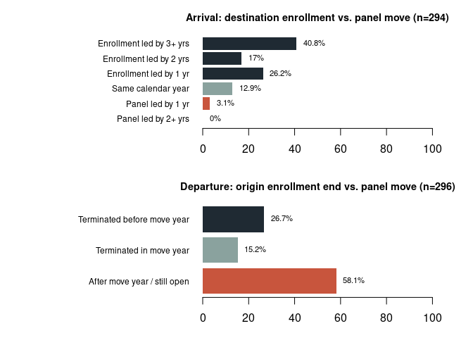
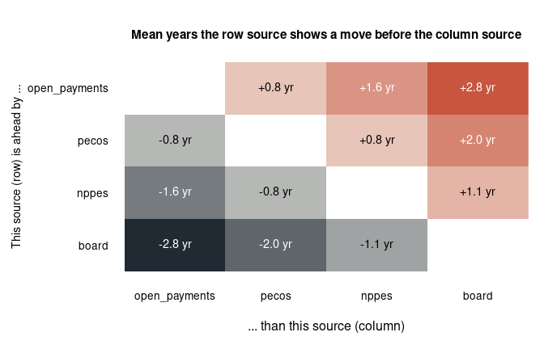

# mysteryroster 

<!-- badges: start -->
[](https://github.com/mufflyt/mysteryroster/actions/workflows/R-CMD-check.yaml)
[](https://lifecycle.r-lib.org/articles/stages.html#experimental)
[](https://opensource.org/licenses/MIT)
[](https://cran.r-project.org/)
[](https://orcid.org/0000-0002-2044-1693)
<!-- badges: end -->

Registry overlap strata and listing-validity analysis for mystery-caller
audits of physician directories -- plus a second, independent toolkit for
comparing sources that disagree when neither one is a gold standard.

## Two questions, two independent toolkits

**Is a physician listing valid?** National physician directories (NPPES,
certifying boards, professional societies) count different physicians and
are rarely checked against reality. A registry-validity study cross-links
them, calls a stratified sample of listed practices, and asks one thing of
each physician-location listing: is the named physician still practising the
indexed specialty at the listed address?

`mysteryroster` is the specialty-agnostic core of that study. It was carved out
of the ENT registry-validity study (Falk et al.) so the OB/GYN subspecialty
study, and any later one, runs the same steps with its own registries and its
own disposition codebook.

**When two or more sources disagree on an attribute and neither is a gold
standard, which one is leading and which is lagging, and when is it safe to
fuse them into one predicted value?** This is the other roughly 30 functions
in the package (about two-thirds of it by function count) -- single
cross-section agreement, longitudinal lead-lag and catch-up-curve approaches,
N-way consensus and corroboration, and truth fusion with explicit abstention.
It shares no functions with the listing-validity workflow above and does not
require it. Skip to [Beyond membership: does a shared attribute
agree?](#beyond-membership-does-a-shared-attribute-agree) if this is why
you're here, or see `?mysteryroster` for the full map.

## Installation

```r
# install.packages("remotes")
remotes::install_github("mufflyt/mysteryroster")
```

## Vignettes

- `vignette("registry-overlap")` -- cross-linking registries into Euler
  zones, the closure guarantee `overlap_zone_counts()` enforces, `frame_strata()`,
  the area-proportional diagram, and a bridge to `attribute_agreement()`.
- `vignette("attribute-agreement")` -- pairwise attribute agreement and
  record freshness across four simulated sources, with three figures.
- `vignette("listing-validity-study")` -- the rest of the pipeline, end to
  end: sampling, call dispositions, design-weighted estimates, sensitivity
  bounds, the survey-weighted model, and the flow/cascade counts, all
  reconciled against one synthetic call log.
- `vignette("lead-lag-staleness")` -- the three longitudinal approaches
  below, first on a three-NPI toy example and then on a simulated
  1,500-clinician panel with eight figures, including the full
  manuscript-paragraph output of `format_no_gold_standard_prose()`.
- `vignette("consensus-and-corroboration")` -- beyond pairwise, with
  three or more sources: how much of the group agrees, whether that
  agreement holds up year over year, which source the group tends
  to converge toward, whether exactly one source is a lone dissenter,
  agreement stratified by any covariate, and Wilson confidence
  intervals on any of the above.
- `vignette("truth-fusion")` -- the one function in this package that
  *does* predict a value rather than only making a relative claim:
  majority-vote inference with explicit abstention on ties or weak
  majorities, and the evidence schema it expects.

## How the pieces fit



Dark boxes are package functions; light shapes are your inputs. Every arrow
is a data frame handed from one call to the next, so the study is a straight
line from registries to tables.

## The study in six calls

```r
library(mysteryroster)

# 1. Cross-link registries by NPI. The first registry is the sampling frame.
ov <- registry_overlap(list(nppes = nppes_npis, board = board_npis, society = society_npis))
overlap_zone_counts(ov)        # seven Euler zones, closure-checked
plot_registry_overlap(ov)      # area-proportional Euler diagram (eulerr)

# 2. Protocol strata: the frame registry's overlap with the others.
frame <- frame_strata(ov, frame = "nppes")

# 3. A stratified sample that keeps its sampling probabilities.
listings <- stratified_listing_sample(
  frame, allocation = c("nppes" = 100, "nppes+board" = 150, "nppes+board+society" = 150),
  seed = 20261009)

# 4. Call dispositions become four exhaustive statuses.
calls <- classify_listing_status(call_log, map = ent_disposition_map())
table(calls$listing_status)    # confirmed_valid / confirmed_invalid / unresolved / not_attempted

# 5. Design-weighted estimates, bounds, and a survey-weighted model.
design <- listing_validity_design(calls)
validity_estimates(design, by = "stratum")
validity_sensitivity_bounds(calls)
validity_model(design, ~ stratum + rural)

# 6. The flow diagram's numbers, closure-checked.
listing_flow_counts(calls, by = "stratum")
```

## Beyond membership: does a shared attribute agree?

`registry_overlap()` only asks whether an NPI is *present* in each source.
`attribute_agreement()` takes that a step further: for every pair of sources
that share an identifier, does a common attribute (practice state, say)
actually agree? There is still no gold standard here -- the comparison is
always pairwise, never against an assumed truth -- and every source's own
freshness date (its record's last-updated date or snapshot/vintage date,
never the date it was downloaded) is carried through so a disagreement
between a 2015 record and a 2024 one reads differently from one between two
current records.

```r
# Coverage/agreement audit across sources that don't share a gold standard,
# with each source's own freshness date -- not download date -- tuning which
# year a row is actually evidence for.
ag <- attribute_agreement(
  list(nppes = nppes_df, pecos = pecos_df, dac = dac_df, open_payments = op_df),
  attribute = "state", year = "year", observed_at = "last_updated")
attribute_agreement_summary(ag)   # n_compared, n_agree, pct_agree per source pair per year
```

`record_age_years()`/`record_age_band()`/`classify_record_staleness()` are
the same freshness-tuning primitives `mysterymedicaid::mm_record_staleness.R`
ports from isochrones, so a disagreement is never read as "one source is
wrong" -- only as "this side provably cannot reflect information the other
side already had."

<p>



</p>

*Simulated sources from `vignette("attribute-agreement")`. Left: agreement
per pair, with no source taken as truth. Middle: for each disagreement,
which side's own record date is provably older. Right: agreement by the
older record's age.*

## When there's no gold standard, but there is time

A single cross-section can only say two sources disagree, not which one
is stale. With repeated annual snapshots, three further approaches (see
`vignette("lead-lag-staleness")`) use timing itself to break that symmetry:

```r
# Approach 1: does Source A or Source B move first, and does the other
# eventually adopt its value, or revert back?
ll <- attribute_lead_lag_matrix(nppes_panel, open_payments_panel,
                                 attributes = c("state", "city", "zip5", "street"),
                                 cross_section = dac_current, cross_section_year = 2026L)

# Approach 2: does agreement decay with how long a source's value has sat unchanged?
panel_b <- attribute_spell_age(nppes_panel, attribute = "street")
attribute_agreement_by_spell_age(dac_current, panel_b, attributes = c("state", "street"))

# Approach 3: do administrative enrollment dates arrive before or after a panel move?
enrollment_move_lead_lag(nppes_panel, medicaid_enrollment_intervals)

# All three, as manuscript-ready paragraphs:
format_no_gold_standard_prose(ll, freshness_strata, enrollment_timing)
```

<p align="center">

</p>

*The three-NPI toy example: who moves first?*

<p>


</p>
<p>


</p>

*Simulated 1,500-clinician panel from `vignette("lead-lag-staleness")`.
Top row (Approach 1): which source breaks concordance first, and what
happens to a disagreement one year later. Bottom left (Approach 2):
agreement by how long Source B's value has sat unchanged. Bottom right
(Approach 3): enrollment arrival and departure dates relative to the
panel move.*

<p align="center">

</p>

*How many years ahead or behind? For every pair of four simulated
sources, the mean number of years the row source shows a clinician's
move before the column source. Only moves both sources eventually show
are counted. `vignette("lead-lag-staleness")` adds a shift-and-match
curve and catch-up curves for the same sources.*

None of the three claims a source is correct -- only that it moved first,
that disagreement tracks a measurable staleness clock, or that an
administrative date landed before or after a panel caught up.

`format_no_gold_standard_prose()` fills in numbers, but its wording (study
years, source-specific mechanisms, verbs like "confirming") is fixed to the
OB/GYN midwifery study. Treat its output as a first draft; see
`?format_no_gold_standard_prose` for what it requires and what it fixes.

## Beyond pairwise: consensus and corroboration

With three or more sources, further relative claims become available --
see `vignette("consensus-and-corroboration")`:

```r
# How much of the group agrees, per identifier-year (never which value is right):
tier <- attribute_consensus_tier(list(nppes = nppes_df, dac = dac_df, op = op_df, pecos = pecos_df),
                                  attribute = "state")

# Does that consensus hold up year over year, or churn?
attribute_consensus_tier_flow(tier)

# Which source does the rest of the comparison set tend to converge toward?
attribute_source_corroboration(list(nppes = nppes_panel, op = op_panel, dac = dac_panel),
                                attributes = "state")

# Is exactly one source a lone dissenter, distinct from a tied split with no majority?
attribute_odd_one_out_rate(attribute_odd_one_out(
  list(nppes = nppes_df, dac = dac_df, op = op_df, pecos = pecos_df), attribute = "state"))

# Does agreement differ by rurality, provider type, or any other covariate?
attribute_agreement_by_covariate(nppes_df, dac_df, rurality_lookup,
                                  attribute = "state", covariate = "setting")

# How much should a percentage above actually be trusted, given its n?
attribute_agreement_add_ci(attribute_agreement_summary(attribute_agreement(sources, attribute = "state")))
```

`attribute_consensus_tier()`, `attribute_consensus_tier_flow()`, and
`wilson_ci()` were ported from a one-off script written for a midwifery
workforce audit outside this package, generalized past that script's
hardcoded assumptions (exactly four sources; one fixed agreement table).
None of these functions ever picks a value as the group's answer --
only the size of the largest agreeing group, whether that size holds up
over time, which source others tend to adopt, whether one source sits
alone outside a shared value, or how much any of the above should be
trusted given how many identifier-years back it.

## Predicting a value: truth fusion

Everything above makes only relative claims -- agreement, timing,
stability -- and deliberately never names a value as correct (see
Design rules, below). `attribute_truth_fusion()` is the one exception:
it predicts a value, with an explicit score, and an explicit option to
abstain rather than guess. See `vignette("truth-fusion")`.


Abstention is a per-entity-year decision (does *this* record have enough
clean evidence to predict a state); reliability is a per-source property
learned across *many* records (how often does this source's evidence end up
matching the fused value). The two are easy to conflate -- a highly
"reliable" source is not a verified-correct one, and two dependent sources
(like DAC and PECOS; see `attribute_claims_collapse_lineage()` above) can
agree with each other and still both be wrong.

```r
claims <- attribute_claims_validate(long_format_claims)  # entity_id/attribute/source_id/claimed_value/reference_year

# Optional: if two or more source_ids share an upstream feed (a classic
# case: a combined registry re-published under two different names), they
# are not independent evidence. Collapse them to one vote first -- agree
# -> one vote; disagree -> no vote; one present -> passed through -- rather
# than let attribute_truth_fusion() count them twice.
claims <- attribute_claims_collapse_lineage(claims, lineage_groups = list(
  combined_registry = c("feed_a", "feed_b")
))

fusion_result <- attribute_truth_fusion(claims, method = "majority", abstain_threshold = 0.6)
fusion_result$predictions        # predicted_value, model_score, abstained, abstention_reason
fusion_result$candidate_scores   # every candidate value's vote share, ranked
attribute_truth_backends()       # which methods/backends are actually available right now

# A manuscript-ready sentence (count, %, Wilson CI) straight from the fit --
# compare_to another attribute_truth_fusion() result for a two-proportion
# test (p-value included) between, say, a baseline and an expanded claims table.
attribute_truth_fusion_prose(fusion_result, result_label = "this fit")$combined_text
```

`method = "majority"` is entirely in R, with no dependency beyond this
package. Two further method families are *optional* second backends via
Python through `reticulate`: `"dawid_skene"`/`"one_coin_dawid_skene"`
(`backend = "crowd_kit"`, Apache-2.0) and `"sums"`/`"average_log"`/
`"investment"`/`"pooled_investment"`/`"truthfinder"` (`backend =
"truthdiscovery"`, **GPL-3.0** -- mysteryroster, MIT, calls it at arm's
length and vendors none of its source). Neither is ever required,
auto-installed, or silently substituted: this package never installs
Python or any Python package, and never modifies a user's global Python
environment. `attribute_truth_backends()` actually probes whether a
user's own configured Python has the relevant module installed before
reporting a backend available; if it isn't, `attribute_truth_fusion()`
errors with that reason rather than silently falling back to
`"majority"`. Unlike `"majority"`, both optional backends fit once,
jointly, across every entity-year for an attribute, estimating one
reliability value per source (`source_diagnostics`) -- and a converged,
confident fit from either is not evidence of accuracy; see
`vignette("truth-fusion-crowdkit")` and
`vignette("truth-fusion-truthdiscovery")` for concrete, verified
demonstrations of exactly how that confidence can be wrong (including
when two sources share an upstream feed, and a real convergence failure
at this package's own default settings), and
`vignette("truth-fusion-case-study-midwifery")` for all three methods
run together, on both real (no-ground-truth) data and a constructed
example where weighted inference provably beats majority vote. CI
actually installs and exercises both optional backends on every push
(`R-CMD-check-crowd-kit`, `R-CMD-check-truthdiscovery`, each in its own
Python environment -- the two packages' dependencies conflict in one),
not just the R-only path, so a regression in either fails CI instead of
silently skipping. A held-out benchmark against real, verified physician
locations is specified but not yet run; see `docs/validation-protocol.md`
for why and `docs/saboteur-test-matrix.md` for the adversarial testing
behind all of the above.

Votes are counted per *source*, not per row, so a source that submits
the same value twice only counts once. Whether a source with two
*conflicting* values (two different claimed states for the same
entity-year, say) is excluded as unresolved or allowed to vote for both
is governed by `on_source_conflict`: `"single_value"` (the default)
excludes it, since one source casting competing votes for the same
entity-attribute-year would otherwise be able to swing an ordinary
categorical majority vote; `"multi_value"` lets it vote for both, for
cases where more than one value can legitimately be true at once, but
`model_score` then reports a share of votes cast, not a probability
that one value is correct. An exact tie always abstains;
`attribute_truth_fusion()` never silently substitutes a different
method or backend than the one requested, and never claims a method is
available before it is actually implemented.

## From protocol to function

| Protocol step | Function |
|---|---|
| Cross-link registries into mutually exclusive overlap zones | `registry_overlap()`, `overlap_zone_counts()`, `plot_registry_overlap()` |
| Restrict to the frame registry; define strata | `frame_strata()` |
| Stratified sample with preserved sampling probabilities | `stratified_listing_sample()` |
| Design weights for a call log sampled elsewhere (N / n from a population table) | `listing_weights()` |
| Dispositions to confirmed valid, confirmed invalid, unresolved, not attempted | `classify_listing_status()`, `ent_disposition_map()`, `obgyn_disposition_map()`, `listing_status_levels()` |
| Design-weighted validity, overall and by stratum; complete-case estimate; location-valid or workforce-valid outcome | `listing_validity_design()`, `validity_estimates()` |
| Extreme-case bounds for unresolved listings | `validity_sensitivity_bounds()` |
| Survey-weighted logistic regression | `validity_model()` |
| Study-flow counts | `listing_flow_counts()` |
| Cascade stages with both denominators (of attempted, of prior stage), weighted or not | `validation_cascade()` |
| Pairwise cross-source agreement on a shared attribute, no gold standard, freshness-tuned by each source's own date | `attribute_agreement()`, `attribute_agreement_summary()`, `record_age_years()`, `record_age_band()`, `classify_record_staleness()` |
| Empirical staleness (consecutive-year spell age) from a multi-year panel alone | `attribute_spell_age()` |
| How often one source's own value changes year to year, independent of whether it's right | `attribute_churn_rate()` |
| Which source actually has data for more entity-years, against a defined universe | `attribute_coverage()` |
| Longitudinal lead-lag: which source moves first, adopts, or reverts, with an optional cross-sectional back-check | `attribute_lead_lag_matrix()` |
| How many years until one source adopts the other's disputed value -- median/IQR/mean/CI, in a manuscript sentence | `attribute_lead_lag_duration()` |
| Catch-up curves across 2+ sources at once, as a proper right-censored Kaplan-Meier survival estimate (never silently drops an identifier that hasn't caught up yet), with a circularity-robust reference mode, shared-lineage grouping, and a confidence interval around the median | `attribute_catch_up_curve()` |
| Manuscript-ready prose for an `attribute_catch_up_curve()` result, ranking sources that resolve and writing an honest sentence for ones that don't, in a terse technical register or a plain-language clinical one | `attribute_catch_up_curve_prose()` |
| Agreement stratified by empirical spell age / career tenure | `attribute_agreement_by_spell_age()` |
| Administrative enrollment arrival/departure timing around a panel move | `enrollment_move_lead_lag()` |
| Manuscript-ready paragraphs from the three lead-lag approaches above | `format_no_gold_standard_prose()` |
| N-way consensus tier (unanimous / majority / split) across 3+ sources at once | `attribute_consensus_tier()` |
| Does a consensus tier persist across years, or churn? | `attribute_consensus_tier_flow()` |
| Per-source ranking: which source does the comparison set converge toward? | `attribute_source_corroboration()` |
| Is exactly one source a lone dissenter (distinct from a tied split with no majority)? | `attribute_odd_one_out()`, `attribute_odd_one_out_rate()` |
| Agreement stratified by any covariate, not just spell age | `attribute_agreement_by_covariate()` |
| Wilson confidence interval on an agreement/concordance rate | `wilson_ci()`, `attribute_agreement_add_ci()` |
| Validate the long-format multi-source claim schema | `attribute_claims_validate()` |
| Collapse a declared group of same-lineage sources (e.g. two feeds from one upstream record) to a single vote before fusion, instead of double-counting them as independent | `attribute_claims_collapse_lineage()` |
| Predict a value by majority vote, or an optional Dawid-Skene-family or TruthFinder-family model, with explicit abstention on ties/weak majorities | `attribute_truth_fusion()` |
| Which truth-fusion methods/backends are actually available right now | `attribute_truth_backends()` |
| Manuscript-ready sentence (count, %, Wilson CI) for one proportion, or two compared via a two-proportion chi-squared test (statistic, df, p-value, and a CI for the difference) | `format_proportion_comparison_prose()` |
| Manuscript-ready sentence ranking 2+ groups by any numeric value (coverage, lead rate, odd-one-out rate, reliability...), with ties flagged rather than hidden behind a false strict order, in a terse technical register or a plain-language clinical one | `format_ranking_prose()` |
| Same, pulled directly from one or two `attribute_truth_fusion()` results, plus a full source-reliability ranking sentence | `attribute_truth_fusion_prose()` |

## Design rules

- **One listing is the unit.** Nothing here aggregates to the physician; do
  that before sampling with your own one-listing-per-NPI rule.
- **Presence is never inferred.** A reached office, a non-missing new-patient
  answer, or board certification does not make a listing valid; only the
  disposition categories in the map do.
- **Unresolved is explicit.** It is reported as its own category, and the
  bounds table shows what the estimate would be if every unresolved listing
  were valid, or invalid.
- **Counts must partition.** Every count-producing function asserts that its
  categories sum to the input, and registry totals must close on their zones.
- **Codebook drift stops the run.** A disposition string outside the map is an
  error unless you ask for `unmapped = "unresolved"`.
- **Attribute agreement is pairwise, never against an assumed truth.**
  `attribute_agreement()` compares every pair of sources that cover the same
  identifier-year; it never picks a "correct" value. A disagreement is read
  against each side's own freshness date only to say one side provably
  predates the other, not to say which is right.
- **`attribute_truth_fusion()` is the one deliberate exception to the
  rule above.** Every other function in this package stops at a
  relative claim; this one predicts a value, on purpose, with an
  explicit score and an explicit abstention path -- it does not pretend
  to follow the "never pick a value" rule it is the exception to.

## Disposition maps

`ent_disposition_map()` is the ENT study's REDCap vocabulary. A new study
supplies the same four categories with its own strings:

```r
obgyn_map <- list(
  at_location   = c("Yes, sees patients here", "Yes, but not accepting new patients"),
  relocated     = "Moved to another practice",
  retired       = c("Retired", "No longer practising"),
  not_specified = "No, reason not given")
classify_listing_status(call_log, map = obgyn_map)
```

## Related packages

- [`mysterynpi`](https://github.com/mufflyt/mysterynpi): name keys and
  agreement rules for linking person rosters to NPI (build the registries here
  first).
- [`mysterycall`](https://github.com/mufflyt/mysterycall): appointment-access
  outcomes, wait-time models, power, and study tooling.
- [`mysterymaps`](https://github.com/mufflyt/mysterymaps): maps for access studies.
- [`mysterymedicaid`](https://github.com/mufflyt/mysterymedicaid): Medicaid MCO
  provider-directory acquisition and audit; the source of the
  `record_age_years()`/`record_age_band()`/`classify_record_staleness()`
  freshness primitives this package ports and makes symmetric.

## Citation

Muffly TM. mysteryroster: registry overlap strata and listing-validity analysis
for mystery-caller audits of physician directories. R package version 0.3.0.
https://github.com/mufflyt/mysteryroster

## License

MIT, Tyler Muffly.
